# giftlet — a personal gift website in two minutes

## Live

**https://giftlet.1426davejobs.workers.dev**

giftlet runs on a Cloudflare Worker (free plan) since 2026-11-08; the Vercel account is blocked and `giftlet.vercel.app` answers 402. Screenshots taken against the live Worker by Playwright in Chrome for Testing.

| | Desktop (1440×900) | Phone (390×844) |
|---|---|---|
| An occasion landing page (birthday) | 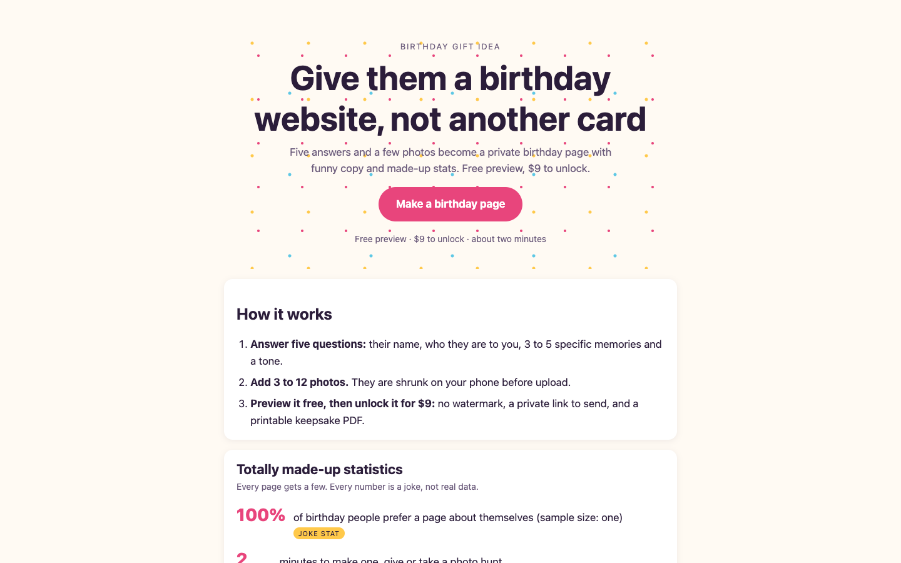 | 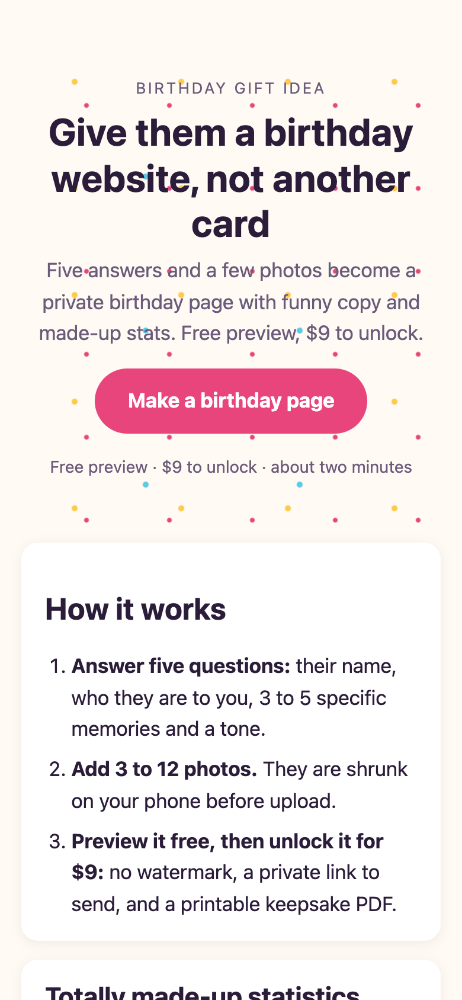 |
| The questionnaire filled in with sample data: a made-up recipient, three memories, three drawn "photos" | 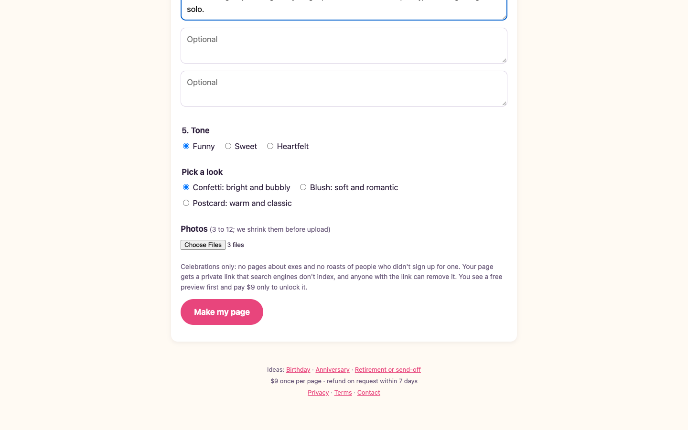 | 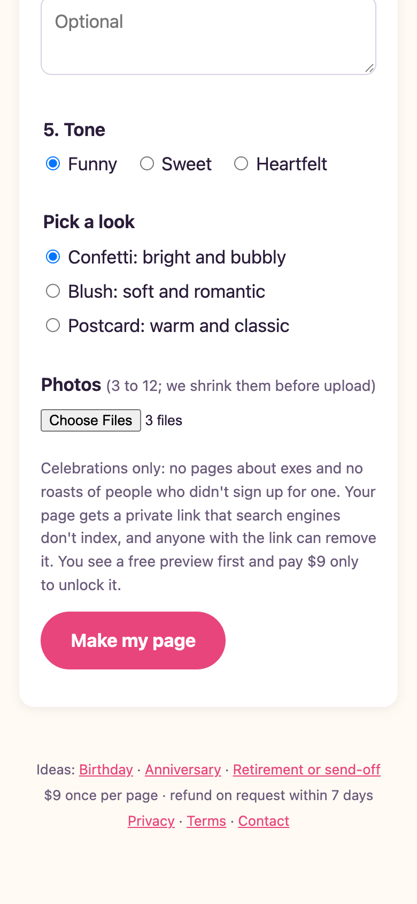 |
| The core action: the gift page it made, a watermarked preview saved in Neon through the Worker (no Buy button: payments aren't set up) | 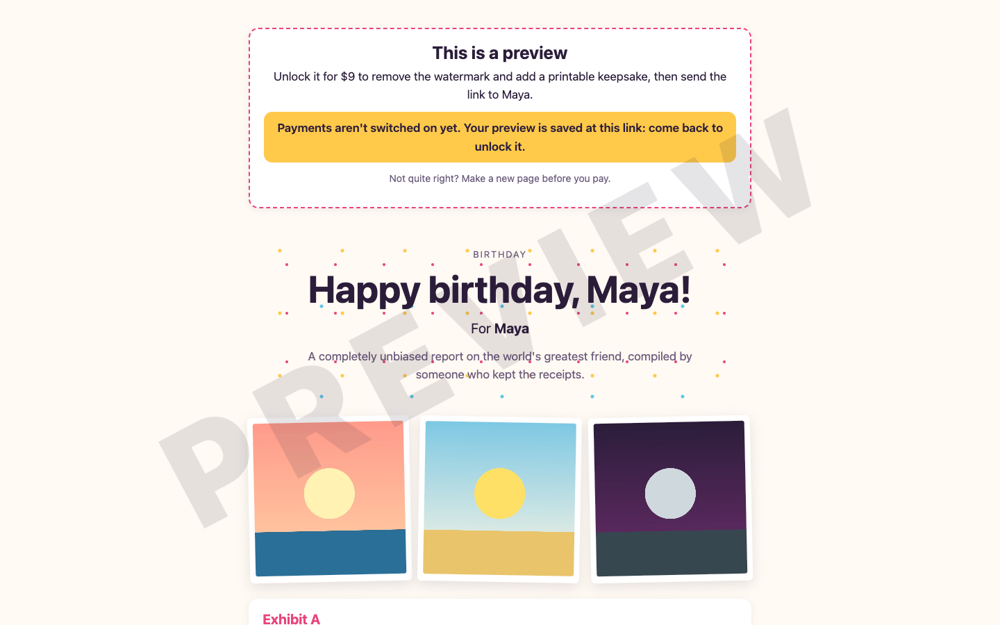 | 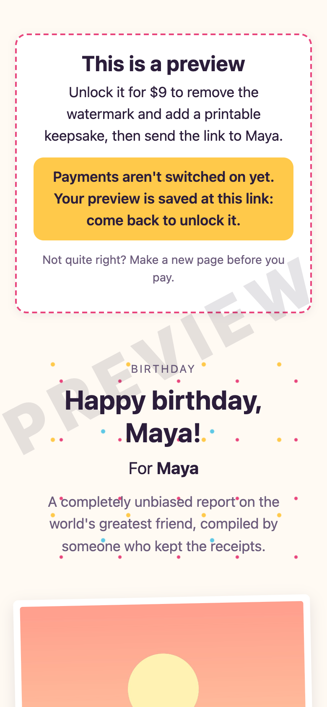 |
| That page removed with its own "Remove this page" link, so the run left nothing behind | 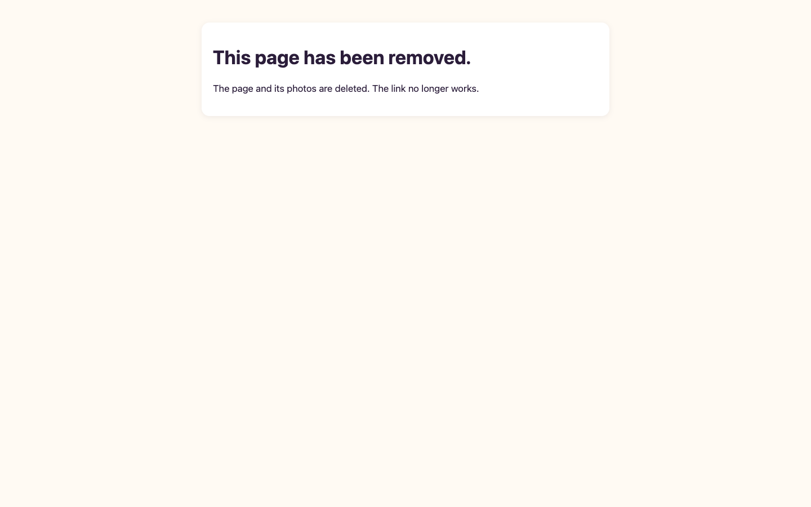 |  |

## Screenshots

Made by `npm run screenshots`: the real app on localhost, driven by Chromium through the buyer's path. It uses sample answers for a made-up "Maya", drawn pictures instead of photos, a placeholder `STRIPE_PAYMENT_LINK` (`https://example.com/pay`, never clicked) and a correctly signed Stripe webhook for a payment-link checkout.

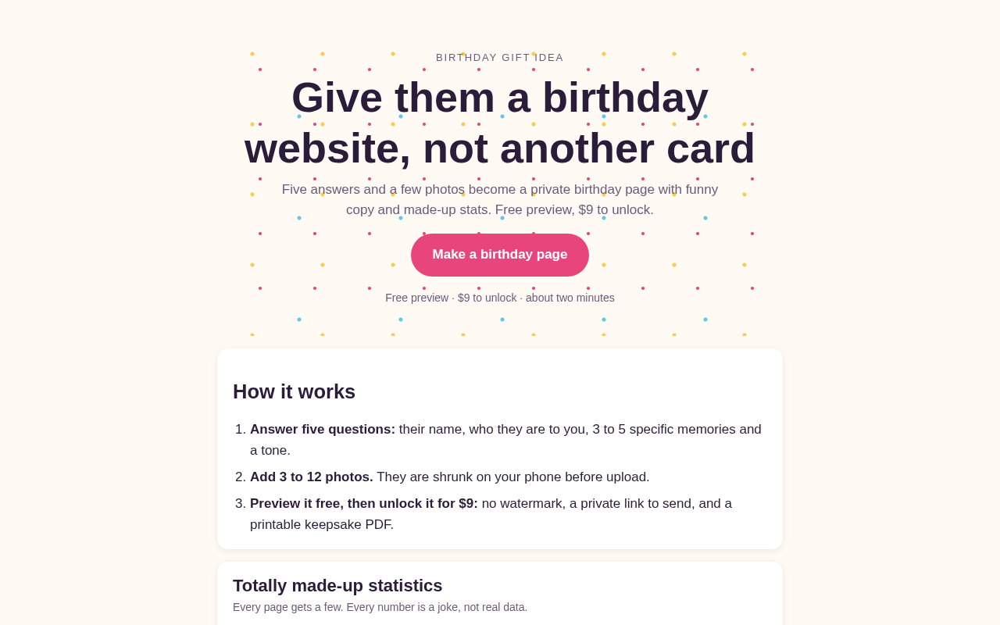
The start page, `/birthday` at 1280×800: the pitch, the price and "Make a birthday page", which opens the form with birthday preselected.

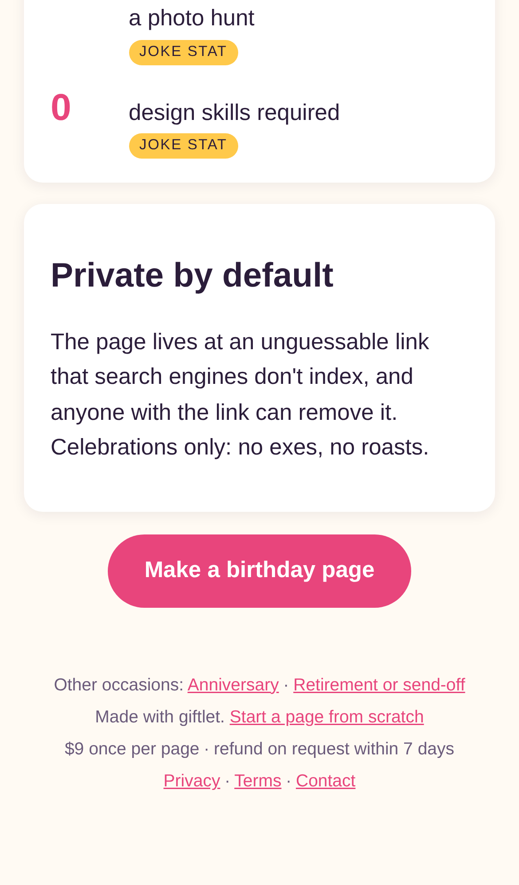
The same page on an iPhone 13, scrolled to the footer: the price and refund line and the Privacy, Terms and Contact links that every public page has.

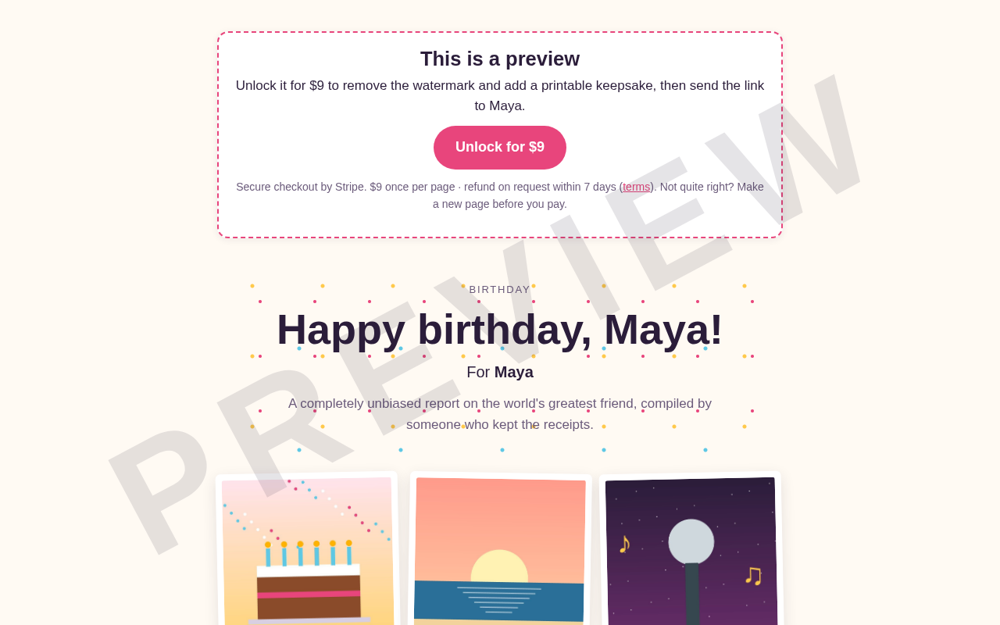
The core action's result: the form, submitted, made this page. It's a watermarked preview whose Buy button ("Unlock for $9") points at the payment link for this page (`?client_reference_id=<page>`, checked by the script).

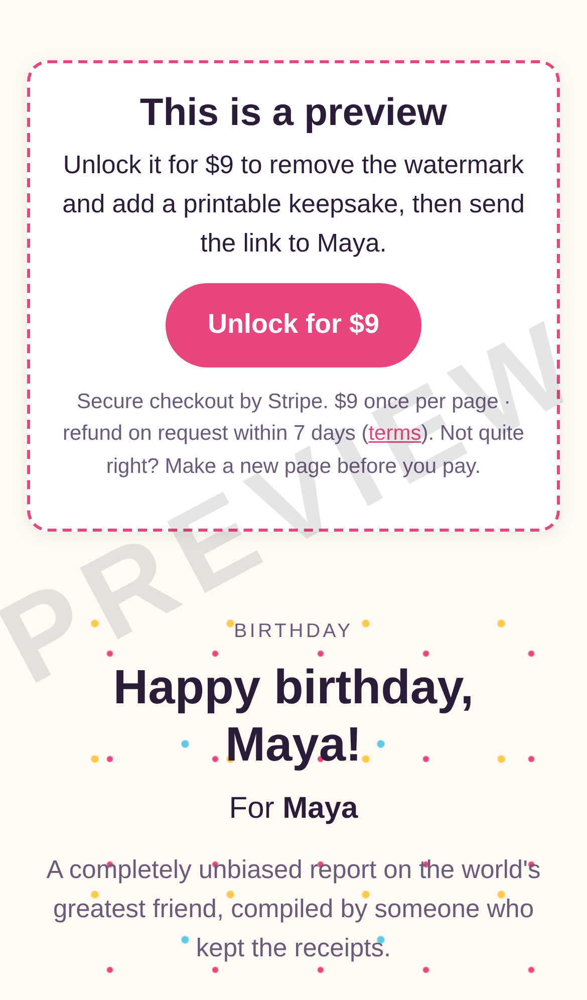
The same preview and Buy button on a phone.

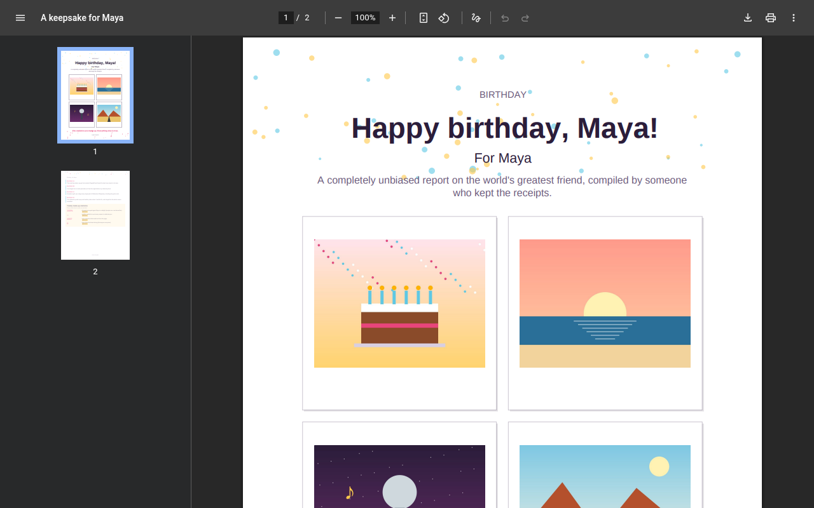
After paying: the webhook unlocked the page and `/paid` sent the buyer back to it. Its printable keepsake (`/p/<page>/print`, 402 until paid) is a 2-page PDF in Chrome's viewer.

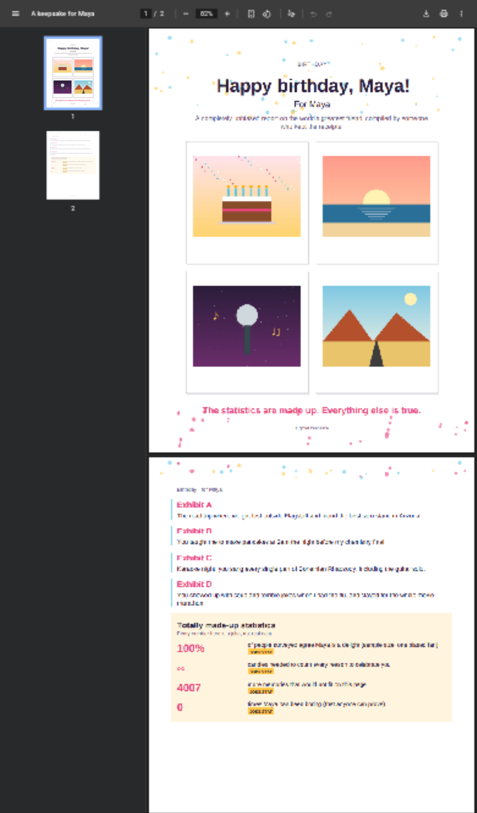
The same PDF at phone size, both pages. Chrome's desktop PDF viewer renders it soft under phone emulation.

For someone with a birthday, anniversary or send-off days away, it turns a few answers and their own photos into a private one-page website with funny AI copy and a printable keepsake for $9–$19.

- [Research](RESEARCH.md) — findings and sources
- [PRD](PRD.md)
- [Roadmap](ROADMAP.md)
- [Build notes](BUILD.md): what works now, how to run and deploy it
- [Launch readiness](LAUNCH-READY.md): search tags, privacy and terms, the Buy button, the usage beacon, and what's left before launch

Effort: Low · Confidence: Low

_Researched by the idea pipeline on 2026-10-13 ([original record](https://github.com/smithdavedesign/idea-factory/tree/main/ideas/giftlet)); repo created on David's go-ahead 2026-10-13._

## Hosting on Cloudflare Workers

Since 2026-11-08 giftlet is the `giftlet` Worker on Cloudflare (free plan, commercial use allowed).
[`src/worker.js`](src/worker.js) serves the same Hono app as [`src/index.js`](src/index.js) (the Vercel entry), wired
from the Worker's env. A Worker can't reuse a socket another request opened, so each request gets its own small `pg`
pool (it connects only when a route queries), ended once the response is ready; the schema runs once per isolate.

```bash
provision cloudflare deploy giftlet "$PWD"             # no build step: wrangler bundles src/worker.js (~300 KiB gzipped)
provision cloudflare secret giftlet DATABASE_URL       # Neon, pushed from the keychain
provision cloudflare secret giftlet GOOGLE_API_KEY     # Gemini (free tier), for the page's words
```

[`wrangler.jsonc`](wrangler.jsonc) sets `SITE_URL` (the Worker's address; change it for a custom domain) and
`NEXT_PUBLIC_DEPLOY_ENV=production`, which turns the usage beacon on (it wins over Vercel's `VERCEL_ENV`). It also turns
esbuild's `keep_names` off, because `/form.js` and `/beacon.js` are functions' source. The Stripe values are read on
every request: `provision stripe giftlet … --host cloudflare` for `STRIPE_PAYMENT_LINK` and `STRIPE_WEBHOOK_SECRET`.
None is stored yet, so pages stay previews with no Buy button.
