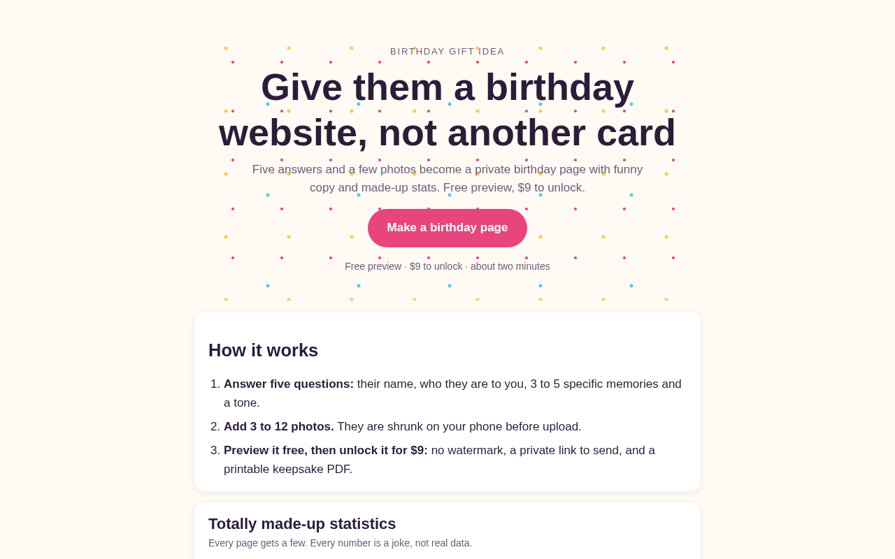
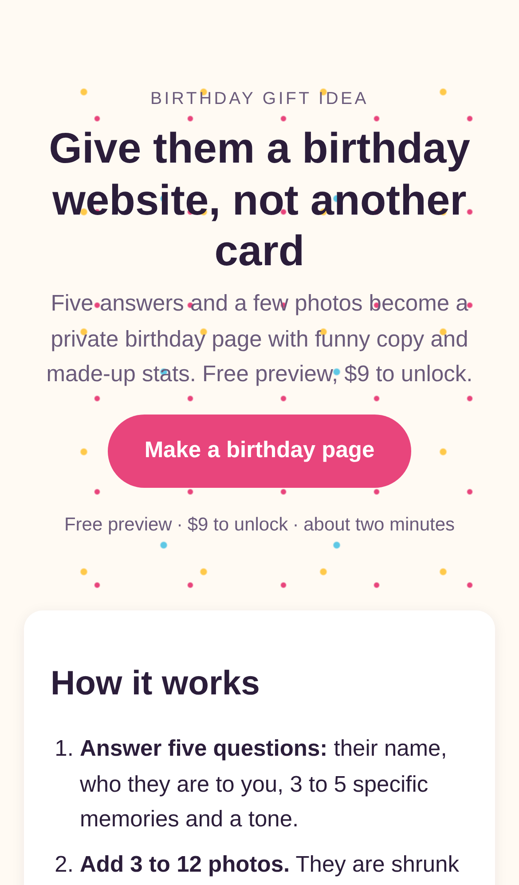
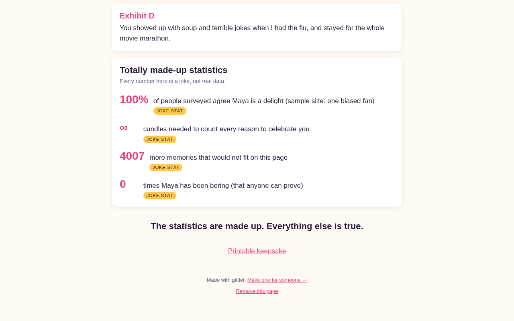
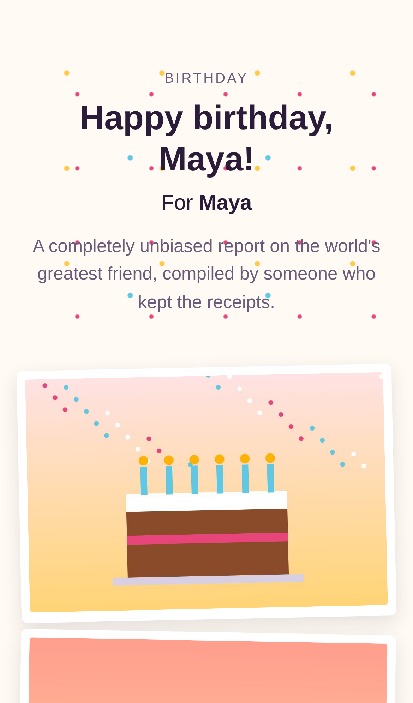
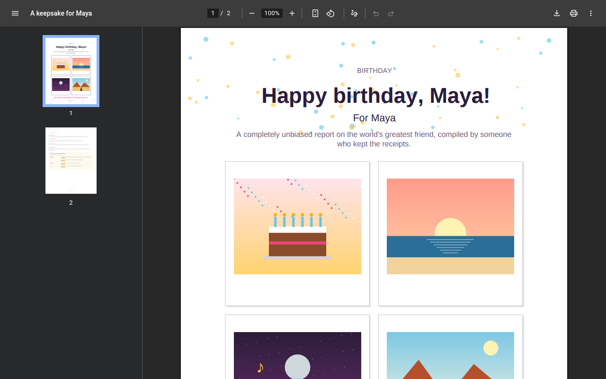
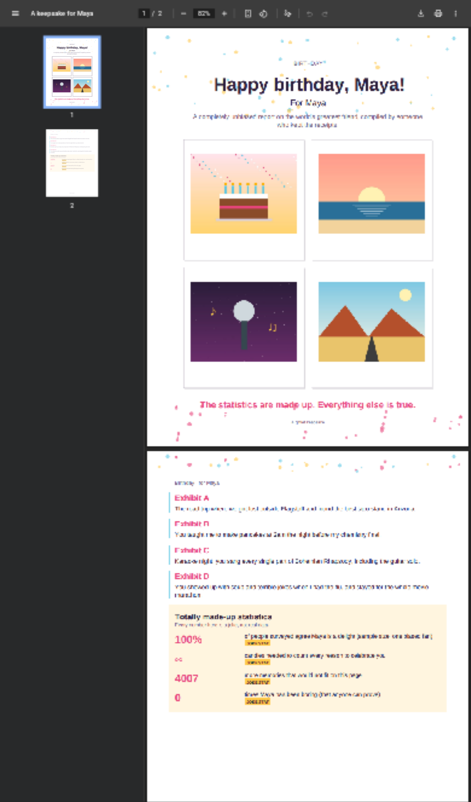

# giftlet — a personal gift website in two minutes

## Screenshots

Made by `npm run screenshots`: the real app on localhost, driven by Chromium through the buyer's path. The form is filled with sample answers for a made-up "Maya", with drawn pictures standing in for photos, and paid with a correctly signed Stripe webhook.

The start page: the `/birthday` landing page, with its "Make a birthday page" link into the form (birthday preselected).

The same landing page on an iPhone 13.

The result after paying: the page made from the form, unlocked (no watermark), with joke-labelled stats, the "Printable keepsake" link and the "Make one" credit.

The same gift page on a phone: headline, name, intro and the uploaded photos.

The keepsake: `GET /p/<slug>/print` for the paid page, a 2-page PDF (cover with photos; memories and joke stats) rendered by Chrome's own PDF viewer.

The same PDF at phone size: both pages, cover and story. Chrome's desktop PDF viewer renders it soft under phone emulation.

For someone with a birthday, anniversary or send-off days away, it turns a few answers and their own photos into a private one-page website with funny AI copy and a printable keepsake for $9–$19.

- [Research](RESEARCH.md) — findings and sources
- [PRD](PRD.md)
- [Roadmap](ROADMAP.md)
- [Build notes](BUILD.md): what works now, how to run and deploy it

Effort: Low · Confidence: Low

_Researched by the idea pipeline on 2026-10-13 ([original record](https://github.com/smithdavedesign/idea-factory/tree/main/ideas/giftlet)); repo created on David's go-ahead 2026-10-13._
